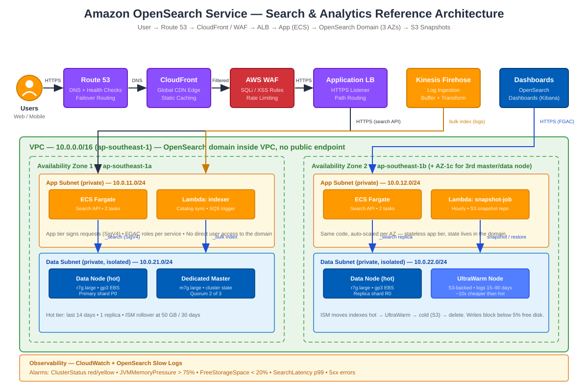

# Amazon OpenSearch Service — Search & Analytics Done Right


> **Search is not a database query with a LIKE clause. It is a different engine,
> built for relevance, fuzzy matching, and aggregations over millions of documents.**
> This guide shows how to run Amazon OpenSearch Service in production — domains
> that survive node failures, indexes that stay fast as data grows, and log
> analytics that don't eat your budget — without the shard and mapping traps
> beginners fall into.

---

## TL;DR

| Question | Short answer |
|---|---|
| What is OpenSearch? | Managed search & analytics engine (fork of Elasticsearch 7.10) — full-text search, log analytics, vector search. |
| When does it win? | Full-text search, faceted product search, log/metrics analytics, SIEM-style querying. |
| When does it lose? | Primary transactional store, strict ACID, simple key lookups (DynamoDB is cheaper). |
| The #1 beginner mistake | Letting OpenSearch auto-create mappings — one bad field type poisons the whole index. |
| The #1 cost mistake | Over-sharding and over-replicating small indexes — every shard is a fixed tax on the cluster. |
| The #1 availability mistake | One AZ, no dedicated masters — a single node failure takes the domain down. |

---

## Architecture



**Traffic flow:** `User → Route 53 → CloudFront / WAF → ALB → App (ECS) → OpenSearch domain (3 AZs, VPC) → S3 (snapshots) + CloudWatch`

The diagram shows the full production shape: edge protection, an application tier
in private subnets, an OpenSearch domain spread across three Availability Zones
with dedicated master nodes, UltraWarm/cold tiers for old logs, automated
snapshots to S3, and dashboards (OpenSearch Dashboards) plus CloudWatch alarms
watching cluster health.

---

## 🌍 In plain words — what is this, really?

OpenSearch is a search engine for your own data, like Google but only for the information inside your company. Instead of scrolling through millions of records one by one, you type a few words and it instantly finds the most relevant results, even if the spelling is slightly off. It can also count and group that data, so you can see patterns like which products are searched most or when errors spike in your logs. Think of it like a super-fast librarian who has memorised every book in a huge library and can also tell you how many books you have on each topic. A normal database is great at finding one exact record by its ID, but OpenSearch is built for exploring words and patterns at scale.

---

## OpenSearch vs. the alternatives

| | OpenSearch | CloudSearch | DynamoDB | RDS (Postgres FTS) |
|---|---|---|---|---|
| Full-text relevance | Excellent | Good | None | Basic |
| Log analytics at scale | Excellent | Poor | Poor | Poor |
| Operational control | High | Low | Low | Medium |
| Managed ops burden | Medium | Low | Very low | Low |
| Best for | Search + analytics | Simple search | Key lookups | Small search on top of SQL |

**Rule of thumb:** if users type words and expect ranked results, you need a
search engine. If they look things up by exact ID, you need a database.

---

## The five things that decide whether OpenSearch works

### 1. Mappings are a design decision, not an accident

OpenSearch guesses field types from the first document it sees. A field indexed
as `text` can't be aggregated; a field indexed as `long` can't hold `"N/A"`.
Define an **index template** before the first document arrives, and set
`dynamic: strict` on production indexes so a bad document fails loudly instead
of silently corrupting the mapping.

### 2. Shards: fewer, bigger, deliberate

| Rule | Why |
|---|---|
| Aim for 10–50 GB per shard | Small shards waste heap; giant shards are slow to recover |
| 1 primary shard per ~50 GB of data | Start small, split with rollover when it grows |
| Replicas = availability, not speed | 1 replica per AZ (3 AZs → 1 replica is usually enough) |
| Use Index State Management (ISM) | Rollover, force-merge, and delete old indexes automatically |

**Cost trap:** 100 tiny indexes × 5 shards × 1 replica = 1,000 shards on a
cluster that needed 50. Every shard costs heap, file handles, and cluster-state
updates.

### 3. Three AZs and dedicated masters, or don't bother

A single-AZ domain is a demo, not production. The production shape:

- **3 AZs**, data nodes spread evenly, 1 replica minimum.
- **3 dedicated master nodes** (one per AZ) — they only manage cluster state,
  so a heavy query can't knock out the control plane.
- **VPC deployment** — no public endpoint; access through the app tier or a
  bastion/VPN, with fine-grained access control (FGAC) + IAM or Cognito auth.

### 4. Hot–warm–cold: logs get cheaper as they age

Not all data deserves fast SSDs. The tiering pattern:

| Tier | Storage | Holds | Query speed |
|---|---|---|---|
| Hot | EBS gp3 / instance store | Last 7–14 days | Fastest |
| UltraWarm | S3-backed | 15–90 days | Slower, ~10x cheaper |
| Cold | S3 | 90+ days, compliance | Slowest, searchable on demand |

ISM policies move indexes between tiers automatically. Most log queries touch
the last 24 hours — paying hot prices for 6-month-old logs is pure waste.

### 5. Observability: watch the cluster, not just the app

- **Cluster health:** `ClusterStatus.red/yellow`, `Nodes`, `CPUUtilization`,
  `JVMMemoryPressure` — alarm at 75% JVM pressure, page at 85%.
- **Search health:** `SearchLatency`, `SearchRate`, `4xx/5xx` from the domain.
- **Disk:** `FreeStorageSpace` — OpenSearch blocks writes at 5% free space.
  ISM deletes and S3 snapshots are your safety valves.
- **Slow logs:** enable search/index slow logs — they find the one bad query
  before users do.

---

## Code

[`opensearch_demo.py`](opensearch_demo.py) is a complete, runnable example:
creates an index with an explicit mapping, bulk-indexes a product catalog,
runs a full-text search with highlighting and aggregations, checks cluster
health, and prints a shard/cost sanity report. Works against any OpenSearch
endpoint — local Docker, or a real domain via IAM SigV4 signing.

```python
# Search sketch — full code in opensearch_demo.py
resp = client.search(index="products", body={
    "query": {"multi_match": {"query": "wireless headphones",
                              "fields": ["name^3", "description"]}},
    "aggs": {"by_brand": {"terms": {"field": "brand.keyword"}}},
    "highlight": {"fields": {"description": {}}},
})
```

Run it against a local OpenSearch container:

```bash
docker run -d -p 9200:9200 -e "discovery.type=single-node" \
  opensearchproject/opensearch:2.15.0
python opensearch_demo.py --endpoint http://localhost:9200 --demo
```

---

## Cost model (ap-southeast-1, 2026)

- **Data nodes:** the dominant cost — e.g. 3× `r7g.large.search` ≈ $380/month.
- **Dedicated masters:** 3× `m7g.large.search` ≈ $190/month (worth every cent).
- **Storage:** EBS gp3 ~$0.09/GB-month; UltraWarm ~$0.008/GB-month.
- **Example:** 500 GB of logs, 14 days hot + 90 days UltraWarm →
  ~$600/month all-in, vs. ~$1,800/month if everything stayed hot.
- **Free levers:** ISM rollover + delete, force-merge old indexes, right-size
  instance types, drop unused replicas on dev domains.

---

## Common mistakes (learn from other people's bills)

1. **Dynamic mapping in production** — one `"price": "free"` document turns a
   numeric field into text and breaks every aggregation.
2. **Too many shards** — 1,000 shards on a 3-node cluster: slow recovery,
   high heap, constant yellow status.
3. **No dedicated masters** — a heavy aggregation triggers a GC storm that
   also takes down cluster management.
4. **Public endpoint without FGAC** — an open search domain is a data breach
   waiting to happen. VPC + FGAC + least-privilege roles.
5. **No snapshots** — a red cluster with no S3 snapshot means rebuilding the
   index from the source of truth, if it still exists.
6. **Querying everything with `*`** — wildcard-leading queries and huge
   `size` values (10,000) are the fastest way to melt a cluster.


---

## Further reading

- [Amazon OpenSearch Service Developer Guide](https://docs.aws.amazon.com/opensearch-service/latest/developerguide/what-is.html)
- [OpenSearch documentation](https://opensearch.org/docs/latest/)
- [Sizing Amazon OpenSearch Service domains](https://docs.aws.amazon.com/opensearch-service/latest/developerguide/sizing-domains.html)
- [Index State Management](https://opensearch.org/docs/latest/im-plugin/ism/index/)

---

*Part of the cloud engineering guide series — one topic, one repo, every day.*
